# SpendWise User Manual

**Version:** 1.0  
**Audience:** SpendWise users  
**Currency:** Amounts in the app are displayed in Sri Lankan rupees (LKR / Rs.).

SpendWise helps you record everyday expenses, set monthly budgets, review your spending patterns, and keep your information synchronized when you sign in.

## Screenshot guide

This manual is ready for screenshots. Save each image in `docs/images/` using the filename shown in the relevant placeholder, then replace the placeholder with a Markdown image link such as:

```markdown
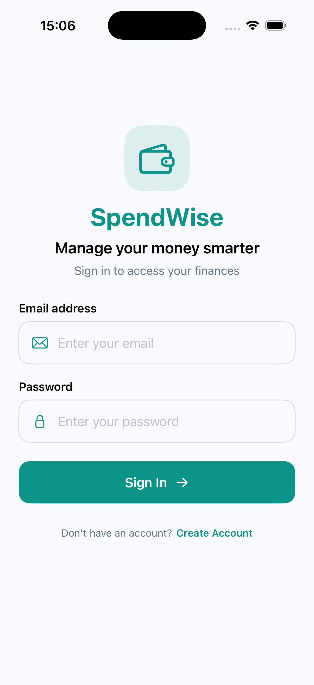
```

Suggested screenshots are listed in [SCREENSHOT_GUIDE.md](SCREENSHOT_GUIDE.md).

## Contents

1. [Getting started](#getting-started)
2. [Sign in or create an account](#sign-in-or-create-an-account)
3. [Home dashboard](#home-dashboard)
4. [Add an expense](#add-an-expense)
5. [Manage expense history](#manage-expense-history)
6. [Set and monitor budgets](#set-and-monitor-budgets)
7. [View insights](#view-insights)
8. [Settings, sync, reminders, and security](#settings-sync-reminders-and-security)
9. [Troubleshooting](#troubleshooting)

## Getting started

1. Open SpendWise.
2. Review the introduction screens. Tap **Continue** to move through them, **Get Started** on the last screen, or **Skip** to continue immediately.
3. Sign in or create an account.
4. After signing in, SpendWise opens the **Home** tab. The tab bar provides access to **Home**, **History**, **Insights**, **Budget**, and **Settings**.

<center>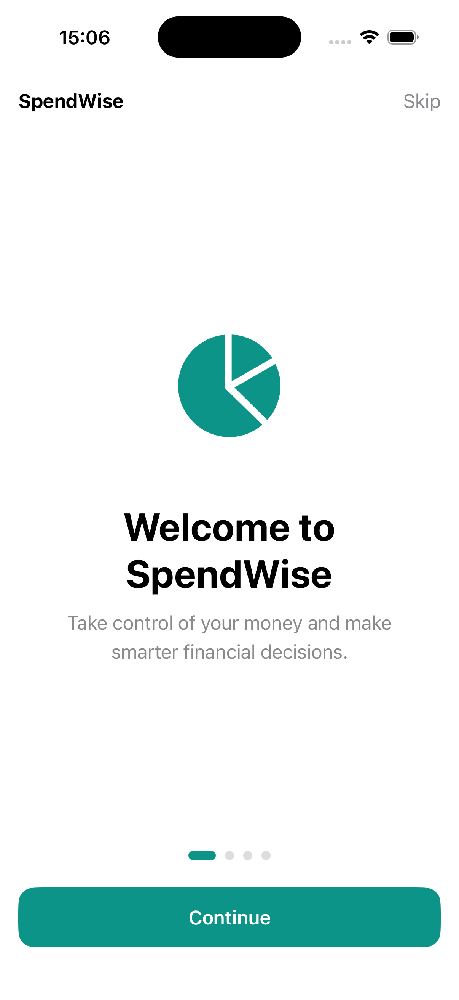</center>

## Sign in or create an account

### Create an account

1. On the sign-in screen, tap **Create Account**.
2. Enter your full name, email address, password, and password confirmation.
3. Tap **Create Account**.
4. After successful registration, SpendWise signs you in and displays your dashboard.

Passwords must contain at least eight characters. If an entry is missing, the email format is invalid, or passwords do not match, correct the message shown on screen and try again.
<center></center>
>
<center>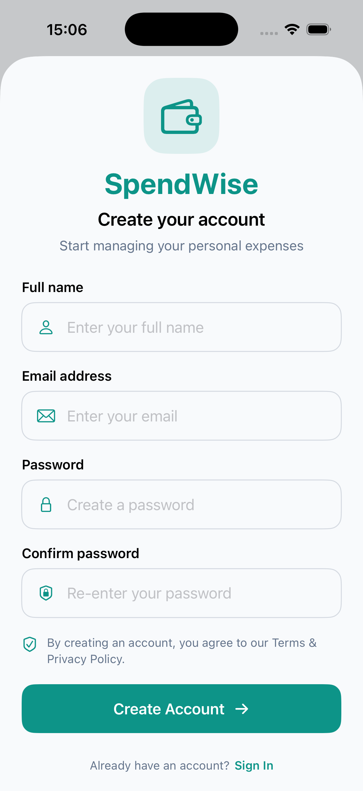</center>

### Sign in

1. Enter your email address and password.
2. Tap **Sign In**.
3. Wait for your data to load. A network connection is needed for authentication and cloud synchronization.

If you see an incorrect-password, invalid-email, or network message, verify your details and connection before retrying.

## Home dashboard

The **Home** tab summarizes the current month.

- **Total Monthly Spending** shows the sum of current-month expenses.
- **Monthly Budget** and **Remaining Budget** compare spending with your saved budget. If spending is higher than the budget, the remaining amount becomes **Amount Over Budget**.
- **Monthly Budget Progress** shows the percentage used. SpendWise highlights 80% usage and over-budget status.
- **Spending Prediction** estimates end-of-month spending from your current pace and available history. It is an estimate, not a guarantee.
- **Recent Expenses** shows recently recorded items.
- **Add Expense** opens the expense form.

Pull down on the Home screen to refresh data when an internet connection is available.

<center>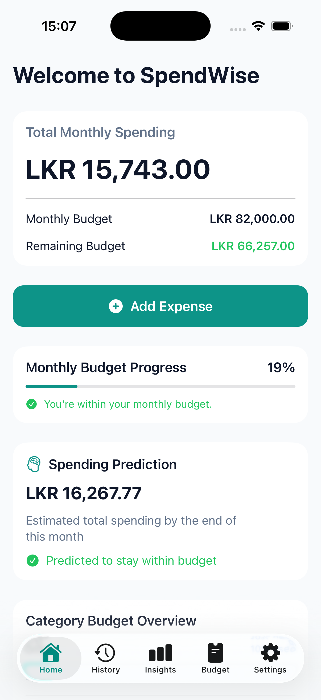</center>

## Add an expense

1. From **Home**, tap **Add Expense**.
2. Enter a positive amount in the **Amount** field.
3. Choose a category: **Food**, **Transport**, **Shopping**, **Bills**, **Entertainment**, **Health**, or **Other**.
4. Optionally enter a merchant name.
5. Optionally attach a receipt, capture the current location, or scan the receipt text as described below.
6. Tap **Save Expense**.
7. In the confirmation message, tap **Done** to return to Home.

SpendWise saves the expense locally first and then attempts to synchronize it to your account. If you are offline, the expense remains on the device and can be synchronized later using **Settings > Sync Now**.

<center>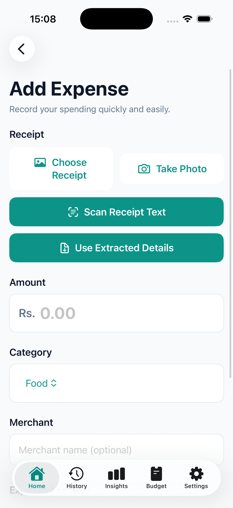</center>

### Add a receipt

You can select an existing receipt image or take a new photo.

1. In the **Receipt** section, tap **Choose Receipt** to select an image, or tap **Take Photo** to open the camera.
2. Grant access when iOS asks for permission.
3. Review the image preview. Tap **Remove Receipt** if you selected the wrong image.
4. The receipt image is stored with the expense when you save it.

<center>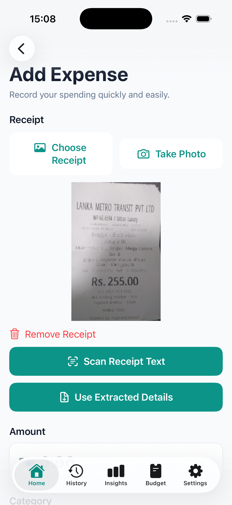</center>

### Scan receipt text

Receipt scanning can suggest a merchant and total amount.

1. Attach a receipt image.
2. Tap **Scan Receipt Text**.
3. Review the suggested merchant, amount, and date in **Extracted Details**.
4. Check the values carefully. Tap **Use Extracted Details** to copy the suggested merchant and amount into the form.
5. Select a category and save the expense.

The scan is a convenience feature. Always verify the extracted amount before saving.

### Save the current location

1. In **Expense Location**, tap **Capture Current Location**.
2. Allow location access when prompted.
3. Wait for the success message and coordinate preview.
4. Save the expense.

The saved location can later be viewed on the expense details map and in the Insights location map.

## Manage expense history

Open the **History** tab to view your saved expenses.

### Find an expense

- Type in **Search category or merchant** to search by category or merchant name.
- Open the **Category** menu and choose a category to filter the list.
- Tap the clear icon in the search field to remove the search text.

Expenses are grouped by date. Tap an expense to open **Expense Details**.

<center>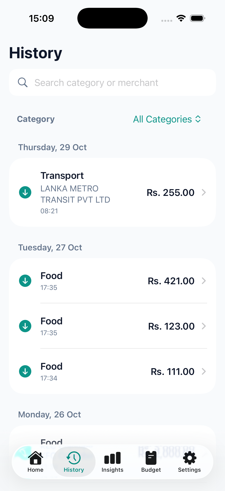</center>

### Review, edit, or delete an expense

The details screen displays the amount, category, merchant, date, time, receipt image, and saved map location when available.

To edit an expense:

1. Open it from **History**.
2. Tap the pencil icon in the top-right corner.
3. Change the fields you need.
4. Save the changes.

To delete an expense:

1. Open it from **History**.
2. Tap **Delete Expense**.
3. Confirm by tapping **Delete Expense** again.

Deletion is permanent. When you are offline, SpendWise keeps the deletion pending and completes it during a later sync.

<center>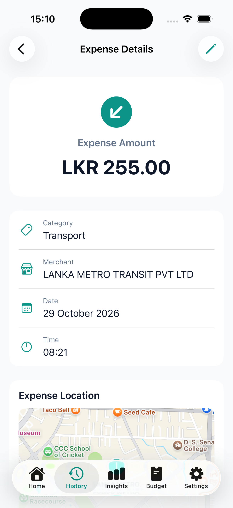</center>

## Set and monitor budgets

Open the **Budget** tab to work with the current month.

### Set the monthly budget

1. Enter a positive amount in **Set Your Budget**.
2. Tap **Save Budget**.
3. Review **Budget Summary** for the monthly limit, amount spent, percentage used, and remaining or over-budget amount.

### Set a category budget

1. In **Category Budgets**, select a category.
2. Enter a positive monthly limit.
3. Tap **Save Category Budget**.
4. Review the category rows below to compare spending with the limit.

SpendWise flags category budgets at 80% usage and when a limit is exceeded.

<center>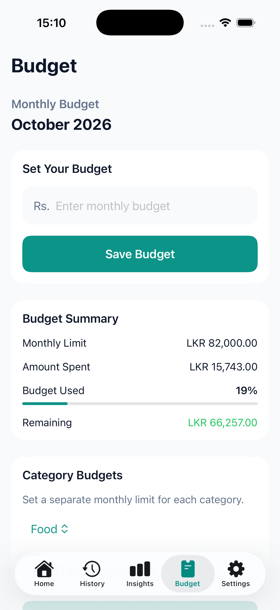</center>

## View insights

Open the **Insights** tab to analyse a selected month.

1. Use the left and right arrows next to the month name to move between months. Future months cannot be selected.
2. Review **Budget Progress**, including total spent, remaining amount, and budget percentage.
3. Review **Spending Summary** for the number of expenses, daily average, and highest-spending category.
4. Use **Spending by Category** to compare categories.
5. Use **Daily Spending Trend** to identify high-spending days.
6. View **Expense Locations** when expenses in the selected month include saved coordinates.

<center>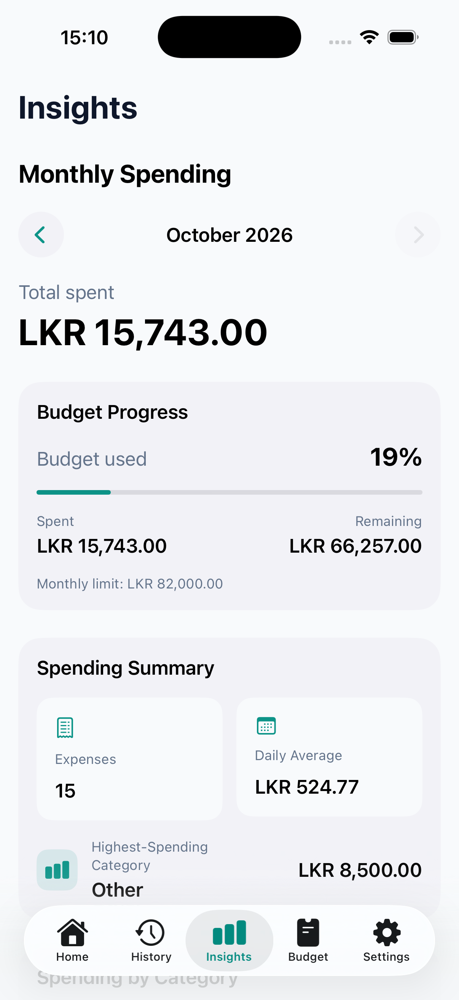</center>

## Settings, sync, reminders, and security

Open the **Settings** tab to manage your account and preferences.

### Synchronize your data

1. Confirm that you are signed in and connected to the internet.
2. Tap **Sync Now**.
3. Wait for the status message. SpendWise processes pending deletions, uploads pending expenses and budgets, then downloads available cloud data.

Use this after working offline or when moving between devices. Do not sign out while a sync is in progress.

### Enable Face ID protection

1. Turn on **Face ID Protection**.
2. Complete the biometric verification prompt.
3. When enabled, SpendWise asks for authentication after the app returns from the background.

Turn the setting off to remove this protection.

### Set a daily reminder

1. Turn on **Enable Daily Reminder**.
2. Allow notifications when iOS asks.
3. Choose a **Reminder Time**.

Turn off the reminder to cancel it. If notifications are disabled in iOS Settings, re-enable them there before setting the reminder again.

### Log out

1. Tap **Log Out**.
2. Confirm the action in the dialog.

Logging out ends the current account session. Sync your changes first whenever possible.

<center>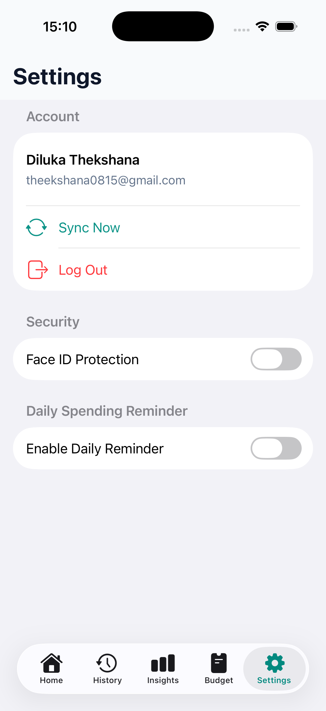</center>

## Troubleshooting

| Problem | What to do |
| --- | --- |
| I cannot sign in. | Check the email and password, then confirm your internet connection. Use a valid email address. |
| My expense did not appear on another device. | On both devices, sign in to the same account, connect to the internet, and choose **Settings > Sync Now**. |
| I cannot take a receipt photo or capture location. | Allow Camera or Location access in iOS Settings for SpendWise, then reopen the feature. |
| Receipt scanning returned no useful result. | Use a clearer, well-lit image with the full receipt visible. Enter the amount and merchant manually if needed. |
| I do not receive reminders. | Enable notifications for SpendWise in iOS Settings, then turn the daily reminder off and on again in the app. |
| The budget warning appears. | Review the Budget tab, reduce upcoming spending, or update the budget if your plan has changed. |

## Good practice

- Save each expense soon after purchase for more accurate insights and forecasts.
- Review OCR suggestions before using them.
- Sync before changing devices, logging out, or relying on a second device.
- Use a device passcode and Face ID protection to protect your financial information.
